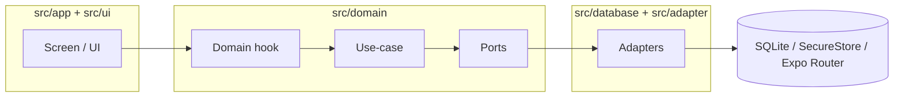

# Architecture overview

## Stack snapshot

- **Runtime**: Expo + React Native + Expo Router (file-based routing)
- **Architecture**: Clean Architecture + Hexagonal (Ports & Adapters)
- **Persistence**: Local-first SQLite via Drizzle ORM (`drizzle-orm/expo-sqlite`)
- **UI**: HeroUI Native wrapped by local Atomic Design components
- **State**: Zustand stores for shared domain state; data loading is done through domain hooks and use-cases (no React Query dependency)
- **Validation**: Zod schemas for use-case requests/responses
- **I18n**: `i18next` + `react-i18next` with typed keys
- **Tooling**: pnpm, Biome (lint/format), Jest (unit), Detox (E2E)

## High-level architecture

The codebase follows **Clean Architecture + Hexagonal Architecture** (Ports & Adapters).

Core wiring happens in:

- Providers + DB init: [src/app/_layout.tsx](../../src/app/_layout.tsx)
- Adapter composition: [src/adapter/index.ts](../../src/adapter/index.ts)

### Layer map

- `src/app/**`: Expo Router screens and layouts (routing + screen composition)
- `src/ui/**`: design system components (Atomic Design) and shared UI utilities
- `src/domain/**`: business logic (entities, use-cases, ports, domain hooks)
- `src/database/**`: Drizzle schema, migrations, SQLite adapters
- `src/adapter/**`: non-DB adapters (navigation, secure store, QR, notify)

## Runtime data flow

Typical flow:

1. Screen reads adapters via `useAdapters()`.
2. Screen calls a domain hook (e.g., `useCreateRecord`).
3. Domain hook instantiates a use-case with injected adapters.
4. Use-case validates request via Zod and calls ports (DB/cache/QR/etc).
5. Adapters implement ports using concrete tech (Drizzle/SQLite, SecureStore, etc.).

## Bootstrapping & composition root

- **SQLite provider**: Wrapped in `SQLiteProvider` and Suspense in [src/app/_layout.tsx](../../src/app/_layout.tsx).
- **Migrations**: Run via `useInitDb()` hook on app start (see [src/database/execute-migrations.ts](../../src/database/execute-migrations.ts)).
- **Adapters**: Created in module scope and "selected" in the `useAdapters()` hook.

## Patterns in practice

- **Ports**: Interfaces like `ICachePort`, `INavigationPort`, `IRecordPort`.
- **Adapters**:
  - Storage: `SecureStoreCacheAdapter` (sensitive data) or `MMKVCacheAdapter` (fast cache).
  - Navigation: `ExpoRouterNavigationAdapter`.
  - DB: `SQLite*Adapter` classes using Drizzle.
  - QR: `QrPortAdapter` (compress+base64) and QR use-cases that chunk data.
- **Use-cases**: Orchestrate business rules, validate with Zod, return typed responses.

## Error handling

- A `BaseUseCase` exists with helper `parseRequest(...)` (Zod safe-parse + throws `ErrorCannotParseSchema`).
- Several use-cases still duplicate `safeParse` and return `{ success:false }` (tracked in [debt.md](../debt.md)).

## Key architectural decisions (current)

- **Local-first persistence**: No mandatory backend—SQLite is the source of truth.
- **"Authentication" as local session**: Device-based session, no PIN implementation yet (see [auth/overview.md](../auth/overview.md)).
- **QR as sync primitive**: Cross-device sharing via compressed QR bundles (see [api/overview.md](../api/overview.md)).

## Performance considerations

- **SQLite queries**: Drizzle generates efficient SQL; indexes on common filters (status, created_at).
- **Cache strategy**: SecureStore for sensitive data, MMKV for fast access.
- **Bundle size**: Tree-shaking unused HeroUI components; lazy-load screens.
- **Memory**: Summary results and preferences are cached through `ICachePort`; Zustand stores are minimal.

## Security measures

- **Data isolation**: All data local to device; no network calls unless user-initiated sync.
- **Sensitive storage**: session values, preferences and summary cache entries use SecureStore. QR payloads are compressed but neither encrypted nor signed. The SQLite database is not encrypted by the app.
- **Input validation**: Zod schemas prevent malformed data from reaching DB.

## Decision history & trade-offs

### Why Clean + Hexagonal in a mobile app?

- **Testability**: Domain logic can be unit-tested without Expo/SQLite dependencies.
- **Evolvability**: Easy to swap implementations (e.g., add cloud sync later).
- **Maintainability**: Clear separation prevents UI bugs from affecting business logic.

Trade-off: More files and "plumbing" than a typical React Native app. For a small team, this pays off as the app grows.

### Why SQLite over AsyncStorage/Realm?

- **ACID compliance**: Reliable transactions for medical data.
- **Query power**: Complex aggregations for reports/summaries.
- **Migration safety**: Drizzle generates schema diffs automatically.

Trade-off: Slightly higher bundle size than AsyncStorage, but worth it for data integrity.

### Why Zustand?

- **Zustand**: Simple state for domain entities that need global access.

Trade-off: global stores can hide data-flow; keep them limited to state that
several screens genuinely share.
