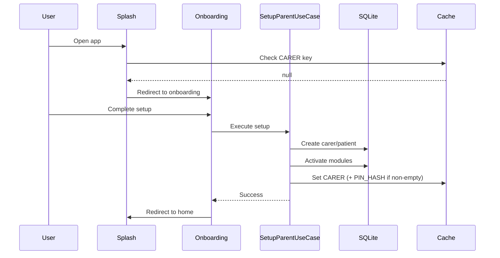
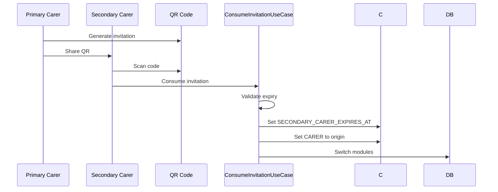

# Auth overview (local-first)

## What "auth" means here

This project has **no remote authentication**. "Authentication" is a local concept for device session management. There is **no PIN or biometric lock implemented** today.

## Core concepts

- **Primary carer**: The main user who sets up the device
- **Session**: Existence of a `carerId` in local cache
- **PIN**: Planned only. `carer.pin_hash` and `CACHE_KEY_ENUM.CARER_PIN_HASH` exist, but new carers are created with an empty hash, no screen sets or verifies a PIN, and no lockout logic exists. Do not treat this as a security control.
- **Secondary carers**: Temporary access via QR invitations. There is no server, revocation or per-record permission enforcement; the secondary device receives a local copy of the data.

## Session lifecycle

### Establishment (onboarding)

Primary carer setup creates the session:

```typescript
// src/domain/carer/use-case/setup-parent.use-case.ts
export class SetupParentUseCase {
  async execute(request: TSetupParentRequest) {
    // Create carer and patient
    const carer = await this.carerPort.create(request.carerData);
    const patient = await this.patientPort.create(request.patientData);

    // Activate selected modules
    await this.modulePort.activateModules(request.selectedModules);

    // Establish session
    await this.cachePort.set(CACHE_KEY_ENUM.CARER, carer.id);
    // pinHash is stored only when non-empty (it currently always is empty)
    if (carer.pinHash) {
      await this.cachePort.set(CACHE_KEY_ENUM.CARER_PIN_HASH, carer.pinHash);
    }

    return { carer, patient };
  }
}
```

- **Atomic setup**: All steps succeed or fail together
- **Session keys**: `carerId` in cache; `pinHash` in SecureStore only if non-empty

### Validation (splash guard)

App startup checks for existing session:

```typescript
// src/domain/carer/hook/use-splash-carer-validation.hook.ts
export const useSplashCarerValidation = () => {
  const { cacheAdapter } = useAdapters();

  useEffect(() => {
    const checkSession = async () => {
      const carerId = await cacheAdapter.get<string>(CACHE_KEY_ENUM.CARER);
      setHasSession(!!carerId);
    };
    checkSession();
  }, [cacheAdapter]);

  return { hasSession };
};
```

- **Cache check**: Fast lookup for `carerId`
- **Guard pattern**: Controls app navigation flow

### Secondary carer mode

QR invitations enable temporary secondary access:

```typescript
// src/domain/carer/use-case/secondary-carer.consume-invitation-qr.use-case.ts
export class ConsumeSecondaryCarerInvitationQRUseCase {
  async execute(qrData: string) {
    const bundle = await this.qrPort.unpack(qrData);
    const invitation = TSecondaryCarerInvitation.parse(bundle);

    // Validate expiry
    if (Date.now() > invitation.expiresAt) {
      throw new ErrorInvitationExpired();
    }

    // Switch session
    await this.cachePort.set(CACHE_KEY_ENUM.SECONDARY_CARER_EXPIRES_AT, invitation.expiresAt);
    await this.cachePort.set(CACHE_KEY_ENUM.CARER, invitation.originCarerId);

    // Switch modules
    await this.modulePort.deactivateAll();
    await this.modulePort.activateModules(invitation.moduleIds);
  }
}
```

- **Temporary access**: Expires at `invitation.expiresAt`
- **Module switching**: Dynamic module activation
- **Session override**: Changes active carer context

### Termination (logout/wipe)

Complete local data destruction:

```typescript
// src/domain/core/use-case/wipe-local-data.use-case.ts
export class WipeLocalDataUseCase {
  async execute() {
    // Clear cache
    await this.cachePort.clearAll();

    // Drop database
    await this.databasePort.dropAllTables();

    // Reset navigation
    await this.navigationPort.navigate('/index');
  }
}
```

- **Destructive**: Removes all user data
- **Privacy-focused**: Complete local reset

## PIN protection

**Not implemented.** There is no `ValidatePinUseCase`, no crypto/hash port and no
PIN screen in the codebase. The only related artifacts are the `pin_hash` column
in the `carer` table and the `CARER_PIN_HASH` cache key; `pinHash` is set to an
empty string during onboarding and secondary-carer creation.

Before claiming PIN protection in the UI or documentation, the feature needs:

- a hashing strategy and a dedicated port (no raw PIN storage);
- a lock screen and lockout policy;
- tests for wrong PIN, missing hash and upgrade/migration paths.

## Cache keys used

```typescript
// src/domain/core/constant/cache-key.constants.ts
export const CACHE_KEY_ENUM = Object.freeze({
  CARER: 'cache-carer',
  CARER_PIN_HASH: 'cache-carer-pin-hash',
  PATIENT: 'cache-patient',
  MODULES: 'cache-modules',
  APP_THEME: 'cache-app-theme',
  APP_LOCALE: 'cache-app-locale',
  REPORT_DISTRIBUTION: 'report_distribution',
  SUMMARY_SNAPSHOT: 'summary_snapshot',
  SECONDARY_CARER_EXPIRES_AT: 'secondary-carer',
} as const);
```

- **Typed enum**: Prevents typos in cache keys
- **SecureStore**: All keys currently use the SecureStore adapter

## Flow diagrams

### Primary onboarding flow



### Secondary carer invitation



## Error scenarios

- **Expired invitation**: `ErrorInvitationExpired`
- **Invalid QR**: Zod validation errors
- **DB failures**: Domain errors during setup
- **Cache failures**: Fallback to no session

## Testing patterns

Auth flows require integration testing:

```typescript
// tests/integration/auth-flow.integration.spec.ts
describe('Auth flow', () => {
  it('should establish session after onboarding', async () => {
    const mockCache = new MockCacheAdapter();
    const adapters = createTestAdapters({ cache: mockCache });

    const useCase = new SetupParentUseCase(adapters);
    await useCase.execute(validRequest);

    expect(mockCache.get(CACHE_KEY_ENUM.CARER)).toBeDefined();
    expect(mockCache.get(CACHE_KEY_ENUM.CARER_PIN_HASH)).toBeDefined();
  });
});
```

- **Mock adapters**: Test without real storage
- **State verification**: Check cache after operations

## Decision history & trade-offs

### Why local-first auth?

- **Offline capability**: Works without internet
- **Privacy**: No user data sent to servers
- **Simplicity**: No OAuth/JWT complexity

Trade-off: No multi-device sync for auth state.

### Why cache-based sessions?

- **Performance**: Instant session checks
- **Framework integration**: Easy with Expo Router guards

Trade-off: Cache clearing breaks sessions (mitigated by DB checks in critical paths).

### Why destructive logout?

- **Medical data privacy**: Complete local data removal
- **Reduced residue**: Removes the app's local rows and cache (no compliance claim)

Trade-off: No "undo" capability; users must re-setup everything.

### Why no PIN yet?

A PIN was planned but is not implemented. The current design relies on the
device lock and app sandbox; see the known limitations in
[SECURITY.md](../../SECURITY.md).

Trade-off: no in-app protection and no second factor; anyone with an unlocked
device can open the app and read the records.
