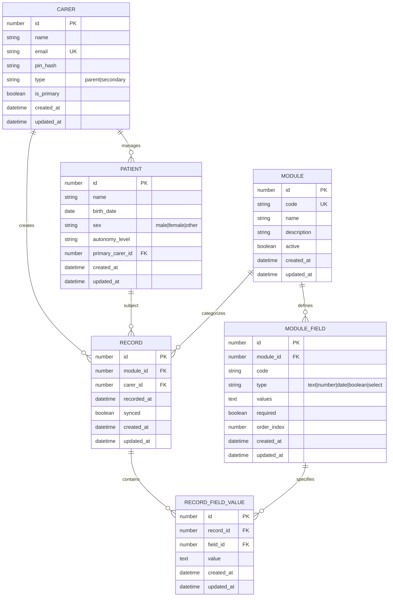

# PostgreSQL schema, ERD diagrams, indexes

**Note:** The Oliva app uses SQLite (expo-sqlite) + Drizzle ORM for local storage. This document describes the conceptual schema that could be adapted to PostgreSQL if needed.

## Core entities and relationships



## Drizzle schema definition

```typescript
// src/database/schema/carers.schema.ts
export const carersTable = sqliteTable('carers', {
  id: integer('id').primaryKey({ autoIncrement: true }),
  name: text('name').notNull(),
  email: text('email').unique(),
  pinHash: text('pin_hash'),
  type: text('type').notNull(), // 'parent' | 'secondary'
  isPrimary: integer('is_primary', { mode: 'boolean' }).notNull().default(false),
  status: integer('status').notNull().default(1),
  createdAt: integer('created_at', { mode: 'timestamp' }).notNull(),
  updatedAt: integer('updated_at', { mode: 'timestamp' }).notNull(),
});

// src/database/schema/patients.schema.ts
export const patientsTable = sqliteTable('patients', {
  id: integer('id').primaryKey({ autoIncrement: true }),
  name: text('name').notNull(),
  birthDate: integer('birth_date', { mode: 'timestamp' }).notNull(),
  sex: text('sex').notNull(), // 'male' | 'female' | 'other'
  autonomyLevel: text('autonomy_level').notNull(),
  primaryCarerId: integer('primary_carer_id').references(() => carersTable.id),
  status: integer('status').notNull().default(1),
  createdAt: integer('created_at', { mode: 'timestamp' }).notNull(),
  updatedAt: integer('updated_at', { mode: 'timestamp' }).notNull(),
});

// src/database/schema/modules.schema.ts
export const modulesTable = sqliteTable('modules', {
  id: integer('id').primaryKey({ autoIncrement: true }),
  code: text('code').notNull().unique(),
  name: text('name').notNull(),
  description: text('description').notNull(),
  active: integer('active', { mode: 'boolean' }).notNull().default(false),
  status: integer('status').notNull().default(1),
  createdAt: integer('created_at', { mode: 'timestamp' }).notNull(),
  updatedAt: integer('updated_at', { mode: 'timestamp' }).notNull(),
});

// src/database/schema/module-fields.schema.ts
export const moduleFieldsTable = sqliteTable('module_fields', {
  id: integer('id').primaryKey({ autoIncrement: true }),
  moduleId: integer('module_id').notNull().references(() => modulesTable.id),
  code: text('code').notNull(),
  type: text('type').notNull(), // 'text' | 'number' | 'date' | 'boolean' | 'select'
  values: text('values'), // Serialized array for select options
  required: integer('required', { mode: 'boolean' }).notNull().default(false),
  orderIndex: integer('order_index').notNull().default(0),
  status: integer('status').notNull().default(1),
  createdAt: integer('created_at', { mode: 'timestamp' }).notNull(),
  updatedAt: integer('updated_at', { mode: 'timestamp' }).notNull(),
}, (table) => ({
  uniqueModuleField: uniqueIndex('unique_module_field').on(table.moduleId, table.code),
}));

// src/database/schema/records.schema.ts
export const recordsTable = sqliteTable('records', {
  id: integer('id').primaryKey({ autoIncrement: true }),
- **Audit trail**: Keep historical data for compliance
- **Simple queries**: Filter active records without complex conditions

Trade-off: Storage overhead and potential confusion about "deleted" vs "inactive".

### Why TEXT for serialized values?

- **Schema flexibility**: Add field options without migrations
- **JSON support**: SQLite handles JSON operations efficiently
- **Simple storage**: Single column for complex select options

Trade-off: No database-level validation of JSON structure.

### Why integer timestamps?

- **Performance**: Faster sorting and range queries
- **Storage**: More compact than ISO date strings
- **Cross-platform**: Consistent across different SQLite implementations

Trade-off: Manual conversion between Date objects and integers.
