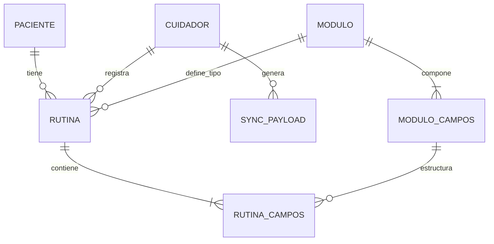

# Modelo de Datos - Base de Datos Local

Este documento describe el esquema de la base de datos local de la aplicación Oliva, basado en un modelo dinámico de módulos y rutinas. La persistencia se gestionará a través de un ORM (DrizzleORM sobre SQLite).

## Diagrama de Entidad-Relación (Conceptual)

Relaciones principales:
- `routines` está relacionada con `carers`, `children` y `modules`.
- `module_fields` pertenece a `modules`.
- `routine_fields` conecta `routines` y `module_fields`.
- `sync_payloads` está relacionada con `carers`.
