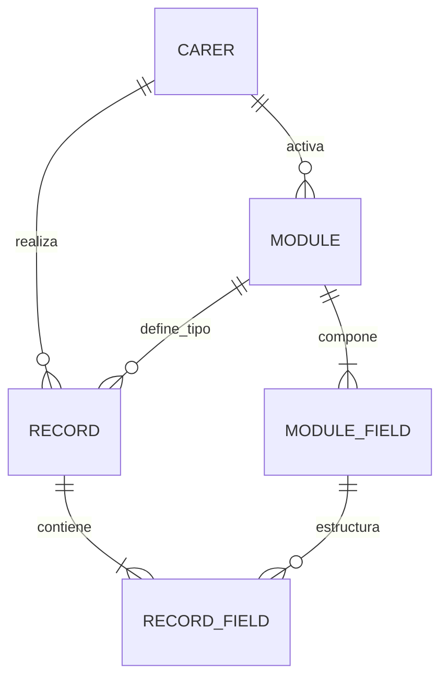

# Modelo de Datos - Base de Datos Local

Este documento describe el esquema de la base de datos local de la aplicación Oliva, basado en un modelo dinámico de módulos y rutinas. La persistencia se gestionará a través de un ORM (DrizzleORM sobre SQLite).

## Diagrama de Entidad-Relación (Conceptual)

Relaciones principales:
- `record` está relacionada con `carer` y `module`.
- `module-field` pertenece a `module`.
- `record-field` conecta `record` y `module-field`.
- `sync_payloads` está relacionada con `carer`.
